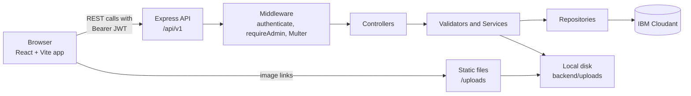

# ReWear – Sustainable Fashion Marketplace

*A student-community platform for discovering, selling, exchanging and donating pre-loved fashion.*

ReWear lets students give clothes a second life instead of leaving them unused in a wardrobe. A student can list a piece for sale, offer it in exchange for another, or donate it. Other students browse the listings and send a request; the owner decides whether to accept it. No payment is taken on the platform, and the owner's phone number is revealed only to the student whose request has been accepted.

The project is a full-stack web application: a React single-page frontend and a Node.js/Express REST API backed by IBM Cloudant.

## Table of Contents

1. [Problem Statement](#problem-statement)
2. [Project Objectives](#project-objectives)
3. [Features](#features)
4. [Technology Stack](#technology-stack)
5. [System Architecture](#system-architecture)
6. [Main User Workflows](#main-user-workflows)
7. [Project Structure](#project-structure)
8. [Prerequisites](#prerequisites)
9. [Installation and Setup](#installation-and-setup)
10. [Environment Configuration](#environment-configuration)
11. [Running the Application](#running-the-application)
12. [Backend API Overview](#backend-api-overview)
13. [Testing](#testing)
14. [Security Considerations](#security-considerations)
15. [Current Limitations](#current-limitations)
16. [Future Scope](#future-scope)
17. [Team](#team)

## Problem Statement

Students regularly outgrow, tire of or no longer need clothes that are still wearable. These pieces often sit unused or are thrown away, while other students look for affordable clothing. General-purpose marketplaces are not built around a campus community, and they push users towards money-only transactions.

ReWear addresses this by giving students one place to pass clothes on, whether by selling, exchanging or donating, so that garments stay in use for longer.

## Project Objectives

- Encourage the reuse of clothing within a student community.
- Offer three ways to pass an item on: sale, exchange and donation.
- Let students browse, search and filter listings easily.
- Keep the hand-over process simple: the owner accepts or declines every request.
- Protect personal information by sharing a contact detail only after a request is accepted.
- Give administrators the tools to handle reported listings and users.

## Features

Everything below is implemented in the repository. Items that are only partly done are marked as such.

| Area | What the application does |
|---|---|
| **Authentication** | Register and log in with name, email and password. Login returns a JWT. The session is kept in browser storage ("Remember me" chooses between persistent and per-tab storage), refreshed with `GET /auth/me` on start-up, and cleared on logout or when the token expires. Pages such as Sell, Donate, Dashboard and Admin are protected routes. |
| **User roles** | Two roles: `student` (default) and `admin`. Admin accounts cannot be created through the API; they are promoted with a command-line script. |
| **Browsing** | Public listing feed with keyword search, category, size, condition and listing-type filters, sorting (newest, oldest, price low to high, price high to low) and cursor-based "Load more" pagination. |
| **Product details** | Listing page with photos, details, owner name and request actions. Viewing a single listing requires a login; guests are redirected to the login page. |
| **Selling** | Create a listing with title, description, category, size, colour, condition and price (whole rupees, 1 to 99,999). |
| **Exchanging** | Create an exchange listing. Another student offers one of their own pieces (title and description) as a request. |
| **Donating** | Create a donation listing (free). Students request it in the same way as other listings. |
| **Listing images** | Up to 5 images per listing (JPEG, PNG or WebP, 5 MB each), stored on the backend's local disk. See [Current Limitations](#current-limitations). |
| **Listing management** | "My Listings" and "My Donations" in the dashboard; delete is allowed while a listing is still available. The backend supports editing, but the Edit button in the dashboard is not wired up yet. |
| **Requests** | Send a request with an optional message. Owners see received requests; requesters see sent requests. Statuses: `pending`, `accepted`, `declined`, `cancelled`, `completed`. |
| **Contact privacy** | The owner must add a phone number to accept requests. The requester sees it only while the request is accepted. |
| **Wishlist** | Save listings with the heart button. The wishlist is stored in the browser only. |
| **Dashboard** | Overview, My Listings, My Requests (received and sent), My Donations, Wishlist, My Reports and Profile. |
| **Reporting** | Logged-in students can report a listing or a seller with a reason (spam, inappropriate, misleading, prohibited item, harassment, other) and optional details. |
| **Administration** | Admin page at `/admin`: report queue with status and type filters, dismiss or resolve a report (optionally removing the reported listing), and an overview of all listings with removal. |

## Technology Stack

| Layer | Technology | Purpose |
|---|---|---|
| Frontend | React 18, React Router 6 | Single-page user interface and routing |
| Frontend | Vite 5 | Development server and build tool |
| Frontend | Tailwind CSS 3, PostCSS, Autoprefixer | Styling |
| Frontend | lucide-react | Icons |
| Backend | Node.js (version 22 or newer) | Runtime |
| Backend | Express 4 | REST API |
| Database | IBM Cloudant (`@ibm-cloud/cloudant`) | Stores users, listings, requests and reports |
| Authentication | `jsonwebtoken` (HS256) | Signed login tokens |
| Authentication | `bcryptjs` | Password hashing |
| Uploads | Multer | Reads multipart image uploads |
| Configuration | `dotenv`, `cors` | Environment variables and cross-origin rules |
| Testing | `node:test` (Node's built-in runner) | Backend tests |
| Dev tooling | nodemon | Backend auto-reload during development |

Image files are saved on the backend's own disk (`backend/uploads/`). The project does not use IBM Cloud Object Storage or any other external file storage.

## System Architecture

The React app talks only to the Express API. The API validates requests, applies business rules and reads and writes IBM Cloudant. Uploaded images go to a local folder that Express serves under `/uploads`.



**Backend layers.** Routes map URLs to controllers. Validators check input. Services hold the business rules. Repositories are the only code that talks to Cloudant. Serializers decide which fields leave the server, so internal fields, emails and contact details are never exposed by accident.

**Frontend modes.** The frontend can run in two modes, selected by the `VITE_API_URL` variable:

- **Mock mode (default):** `VITE_API_URL` is empty. The app uses built-in demo data and a demo login. Nothing is saved, and no backend is needed.
- **Real mode:** `VITE_API_URL` points at the backend. Every call goes to the Express API and data is stored in Cloudant.

Reporting, the "My Reports" tab, the phone number field and the admin page are available in real mode only.

## Main User Workflows

**Account.** A student registers (name, email, password) and is signed in immediately. Passwords must be at least 8 characters. The profile can be edited from the dashboard; name and phone number are saved to the account.

**Listing an item.** From Sell or Donate, the student fills in the listing form. The app first creates the listing and then uploads the photos in a second call. If the photo upload fails, the listing is kept and the student is told clearly, instead of the listing being silently deleted.

**Requesting an item.** On a product page the student sends a purchase request, a donation request, or (for exchange listings) offers one of their own pieces. A student cannot request their own listing and cannot send two requests for the same listing.

**Handling a request.**

```
pending  -> accepted    owner accepts; the listing becomes reserved and leaves the public feed;
                        other pending requests on it are declined
pending  -> declined    owner declines
pending  -> cancelled   requester withdraws
accepted -> completed   owner marks the hand-over as done
accepted -> cancelled   owner or requester calls it off; the listing becomes available again
```

**Exchange.** An exchange request carries a text description of the offered item. The offered item is not reserved in the system; it remains listed.

**Reporting and moderation.** A student reports a listing or a seller. An administrator opens `/admin`, reviews the report, and either dismisses it or resolves it, optionally removing the reported listing. Decisions are final. The reported person has no way to see that a report exists. User reports are recorded and resolved, but accounts are not blocked automatically.

## Project Structure

```
ReWear/
├── backend/                     Express REST API
│   ├── src/
│   │   ├── server.js, app.js    Entry point and Express app
│   │   ├── config/              Environment, constants, Cloudant client, database indexes
│   │   ├── routes/              URL to controller mapping
│   │   ├── controllers/         HTTP handlers
│   │   ├── validators/          Input checks
│   │   ├── services/            Business rules (auth, listings, requests, reports, admin, storage)
│   │   ├── repositories/        All Cloudant access
│   │   ├── serializers/         Safe response shapes
│   │   ├── middleware/          authenticate, requireAdmin, uploadImages
│   │   └── utils/               Tokens, errors, image type check, helpers
│   ├── scripts/                 Database setup, admin promotion, read-only verification scripts
│   ├── tests/                   Automated tests and a fake Cloudant
│   ├── .env.example             Backend environment template
│   └── uploads/                 Uploaded images (created at run time, ignored by Git)
├── FRONTEND/                    React single-page app
│   ├── src/
│   │   ├── pages/               Home, Explore, Exchange, ProductDetails, Sell, Donate,
│   │   │                        Dashboard, Admin, Login, Signup, About
│   │   ├── components/          Navbar, ListingForm, FilterSidebar, ReportModal, RequestRow, ...
│   │   ├── context/             Authentication and wishlist state
│   │   ├── services/            API client, session handling, data mappers
│   │   └── data/                Demo data used in mock mode
│   ├── public/images/           Static images used by the interface
│   ├── scripts/                 Frontend smoke test
│   └── .env.example             Frontend environment template
├── backend/README.md            Detailed backend and API documentation
└── TASK11_PROGRESS.md           Development notes on frontend-backend integration
```

## Prerequisites

- **Node.js 22 or newer** and npm (required by the backend; check with `node -v`).
- **Git**, to clone the repository.
- **An IBM Cloud account with a Cloudant instance**, only if you want to run in real mode. You need the instance URL and an API key from the instance's *Service credentials*. Mock mode needs none of this.

## Installation and Setup

### 1. Clone the repository

```bash
git clone https://github.com/rashimane07-glitch/ReWear.git
cd ReWear
```

### 2. Set up the backend (real mode)

Run these in a terminal:

```bash
cd backend
npm install
```

Create your environment file from the template (use `copy` on Windows, `cp` on macOS and Linux), then open `.env` and fill in your own values. See [Environment Configuration](#environment-configuration).

```bash
# Windows
copy .env.example .env

# macOS / Linux
cp .env.example .env
```

Create the database and its indexes (safe to repeat):

```bash
npm run db:setup
```

### 3. Set up the frontend

Open a **second** terminal in the project root:

```bash
cd FRONTEND
npm install
```

To use the real backend, create `FRONTEND/.env` from the template and set `VITE_API_URL` as described below. To try the interface with demo data only, skip this step.

## Environment Configuration

Never commit `.env` files. Both `.gitignore` files already exclude them. Use placeholders such as the ones below, and keep real values private.

### Backend: `backend/.env`

| Variable | Required | Purpose |
|---|---|---|
| `PORT` | No (default `5000`) | Port the API listens on |
| `NODE_ENV` | No (default `development`) | Runtime mode |
| `FRONTEND_URL` | No (default `http://localhost:5173`) | Frontend address allowed by CORS |
| `JWT_SECRET` | **Yes**, for register and login | Secret used to sign tokens; at least 32 characters |
| `JWT_EXPIRES_IN` | No (default `7d`) | Token lifetime, for example `7d`, `12h` or `3600` (seconds) |
| `CLOUDANT_URL` | **Yes**, for any data | Cloudant instance address |
| `CLOUDANT_APIKEY` | **Yes**, for any data | IAM API key from the Cloudant service credentials |
| `CLOUDANT_DATABASE` | No (default `rewear`) | Database name |
| `BACKEND_URL` | No (default `http://localhost:<PORT>`) | Public address of the backend, used in image links |
| `UPLOADS_DIR` | No (default `uploads`) | Folder for uploaded images, relative to `backend/` |

Example with placeholders only:

```env
PORT=5000
NODE_ENV=development
FRONTEND_URL=http://localhost:5173
JWT_SECRET=<a-random-string-of-at-least-32-characters>
JWT_EXPIRES_IN=7d
CLOUDANT_URL=https://<your-instance>.cloudantnosqldb.appdomain.cloud
CLOUDANT_APIKEY=<your-cloudant-api-key>
CLOUDANT_DATABASE=rewear
BACKEND_URL=http://localhost:5000
```

A suitable secret can be generated with:

```bash
node -e "console.log(require('crypto').randomBytes(48).toString('hex'))"
```

The server starts even when these values are missing. It then reports what is not configured, and register, login and database features answer with a clear "not configured" error until they are set.

### Frontend: `FRONTEND/.env`

| Variable | Purpose |
|---|---|
| `VITE_API_URL` | Leave **empty** for mock mode. Set to `http://localhost:5000/api/v1` for real mode. |

Vite reads this file only at start-up, so restart `npm run dev` after changing it.

## Running the Application

**Terminal 1: backend**

```bash
cd backend
npm run dev        # auto-reload; use "npm start" for a plain start
```

Check it at <http://localhost:5000/api/v1/health>. The database connection can be checked at <http://localhost:5000/api/v1/health/database>.

**Terminal 2: frontend**

```bash
cd FRONTEND
npm run dev
```

Open <http://localhost:5173>.

**Mock mode demo login:** `demo@rewear.test` / `demo1234`. Mock data resets when the page is refreshed.

**Creating an administrator.** Register a normal account in the app, then run this on the machine that has `backend/.env`, and log in again:

```bash
cd backend
npm run admin:create -- student@example.com
```

Use `npm run admin:demote -- student@example.com` to reverse it. The admin page is at `/admin` (there is no navigation link to it).

### Available scripts

| Location | Command | Description |
|---|---|---|
| `backend` | `npm run dev` / `npm start` | Start the API with or without auto-reload |
| `backend` | `npm test` | Run the backend tests |
| `backend` | `npm run db:setup` | Create the database and indexes if missing |
| `backend` | `npm run admin:create -- <email>` | Promote an existing account to administrator |
| `backend` | `npm run admin:demote -- <email>` | Return an administrator to a normal student |
| `backend` | `npm run db:verify-browse`, `db:verify-requests`, `db:verify-reports` | Read-only checks of the queries and indexes against real Cloudant |
| `FRONTEND` | `npm run dev` | Start the Vite development server |
| `FRONTEND` | `npm run build` | Create a production build |
| `FRONTEND` | `npm run preview` | Preview the production build |
| `FRONTEND` | `npm run test:smoke` | Smoke test of the mock data layer |

## Backend API Overview

Base URL: `/api/v1`. Successful responses look like `{ "success": true, "data": ..., "meta": ... }`; errors look like `{ "success": false, "error": { "code", "message", "details?" } }`. Protected routes expect `Authorization: Bearer <token>`.

| Method and path | Login | Purpose |
|---|---|---|
| `GET /health`, `GET /health/database` | No | Status checks |
| `POST /auth/register`, `POST /auth/login` | No | Create an account, log in |
| `GET /auth/me` | Yes | Current user |
| `PATCH /users/me` | Yes | Update name and contact |
| `GET /listings` | No | Browse, search, filter, sort, paginate |
| `POST /listings` | Yes | Create a listing |
| `GET /listings/mine` | Yes | Own listings |
| `GET /listings/:id` | Yes | One listing |
| `PATCH /listings/:id`, `DELETE /listings/:id` | Owner | Edit or delete (only while available) |
| `POST /listings/:id/images` | Owner | Upload up to 5 images (field name `images`) |
| `POST /requests` | Yes | Request a listing |
| `GET /requests/received`, `GET /requests/sent` | Yes | Request lists |
| `GET /requests/:id` | Owner or requester | One request |
| `POST /requests/:id/accept`, `/decline`, `/complete` | Owner | Answer a request, complete the hand-over |
| `POST /requests/:id/cancel` | Requester or owner | Withdraw or call off |
| `POST /reports`, `GET /reports/mine` | Yes | Report a listing or user, view own reports |
| `GET /admin/listings`, `POST /admin/listings/:id/remove` | Admin | List all listings, remove one |
| `GET /admin/reports`, `GET /admin/reports/:id` | Admin | Report queue, one report |
| `POST /admin/reports/:id/dismiss`, `/resolve` | Admin | Decide a report |

Filters, error codes, pagination and the privacy rules are described in full in [`backend/README.md`](backend/README.md).

## Testing

**Backend automated tests**

```bash
cd backend
npm test
```

The tests use Node's built-in test runner and an in-memory fake of Cloudant, so they need no internet connection or credentials. They cover validators, listing creation and image handling, browsing, requests and exchange, reports and the admin area.

The project's development notes (`backend/TASK10_PROGRESS.md`) record 302 passing tests at the end of Task 10. That figure was not re-checked while preparing this README, so run `npm test` for the current result. Because the tests use a fake database, they show that the backend sends the intended queries but do not prove how real Cloudant behaves. The `db:verify-*` scripts exist to check the queries and indexes against a real Cloudant instance without writing data.

**Frontend smoke test**

```bash
cd FRONTEND
npm run test:smoke
```

This checks the demo (mock) data layer only. According to `TASK11_PROGRESS.md`, the frontend production build and the complete browser flow against the real backend were still to be verified by the team when those notes were written.

## Security Considerations

- **Passwords** are hashed with bcrypt (`bcryptjs`, 10 rounds) and never stored or returned in plain text.
- **Login tokens** are HS256 JWTs. The server refuses to issue tokens unless `JWT_SECRET` is at least 32 characters, and verification accepts only that algorithm.
- **Login errors** are generic (invalid email or password) and take similar time for unknown emails, so accounts cannot be discovered through login.
- **Roles:** a `role` sent at registration is ignored. Admin routes check the role in the database on every call, not only in the token.
- **Input validation:** request bodies and query strings are validated, and unknown fields or parameters are rejected.
- **Uploads:** the file type is checked from the file's contents, not its name; there are limits of 5 files and 5 MB per file. The uploads folder is served read-only without directory listings, and hidden files are denied.
- **Privacy:** serializers expose only chosen fields. Emails and contact details never appear in listings or request lists. A contact detail is available only to the requester of an accepted request.
- **CORS** is restricted to the configured `FRONTEND_URL`.
- **Secrets:** `.env` files are excluded from Git; only `.env.example` templates are committed. Error responses do not contain stack traces or credentials.

## Current Limitations

- **Image display has not been verified.** Image upload and storage are implemented, but correct display of listing images in the running application has not been confirmed, and this is being looked at separately. Treat image behaviour as unverified.
- **Frontend integration is not fully tested.** Per the development notes, the frontend build and a complete browser walk-through against the real backend were still pending.
- **Editing a listing** from the dashboard is not available yet, although the backend supports it.
- **No payments, delivery or in-app chat.** Hand-over is arranged directly between students after acceptance, using the owner's phone number.
- **Profile fields:** the backend stores only name and phone contact. College and location shown in the profile are kept on the user's device only.
- **Exchange offers** are text descriptions; the offered item is not reserved.
- **"Trending" on the home page** shows the newest listings, because the backend has no trending ranking.
- **Maximum-price slider** on Explore is applied in the browser, as the backend has no price filter.
- **Wishlist** is stored in the browser, so it is not shared between devices.
- **Search** scans available listings and suits a campus-sized marketplace; it will slow down at much larger scale.
- **Request and report lists** are capped at 200 entries.
- **Users cannot be blocked** by administrators; user reports are only recorded and resolved.
- **Footer:** the newsletter form and social media links are placeholders.
- **Sessions** are stateless JWTs stored in the browser; logging out forgets the token but there is no server-side revocation.

## Future Scope

These are ideas only and are **not** implemented:

- Edit listings from the dashboard.
- Account blocking or suspension for administrators.
- In-app notifications for new requests and status changes.
- A price filter and a real trending or recommendation ranking on the server.
- Seller profile fields such as college and location stored on the account.
- Reserving the offered item in an exchange.
- Rate limiting for login and other sensitive endpoints.
- Hosted deployment and a production configuration.
- Automated frontend tests.

## Team

> **To be confirmed:** no team member names, roll numbers or responsibilities are recorded in the project's existing documentation. Please fill in this table before submission.

| Name | Roll number | Role / responsibilities |
|---|---|---|
| _to be added_ | _to be added_ | _to be added_ |

**Repository:** <https://github.com/rashimane07-glitch/ReWear>
